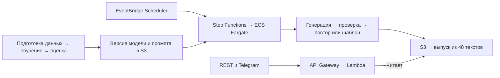
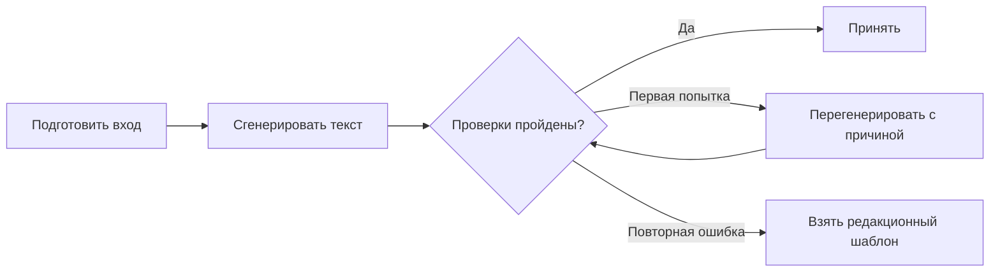

# Agata — архитектура сервиса ежедневных гороскопов

Это исходное архитектурное предложение. Реализованная версия описана в [README](README.md), [инструкции AWS](docs/aws.md) и [инструкции по LoRA](lora_train/README.md).

Agata выдаёт короткий развлекательный гороскоп на русском по знаку зодиака и теме. Предлагаю начать с четырёх тем: общий, отношения, работа и финансы. На каждый календарный день сервис заранее готовит 48 текстов. API и Telegram читают готовые результаты, поэтому время ответа пользователю не зависит от времени генерации. Основной эксперимент проекта — выяснить, улучшает ли LoRA соблюдение темы и качество русского текста по сравнению с той же моделью без адаптера.

## Что переносим из исходного проекта

- В `LLM+peft for horoscope-based predictions.ipynb` указан `dkagramanyan/horoscopes_ru`, но в `Trainer` передаётся результат токенизации одного длинного текста. Установлен `max_steps=1`. Этот ноутбук полезен как история эксперимента.
- В `Agata_peft_model.ipynb` активный источник — CSV из Kaggle. Hugging Face загрузка закомментирована. Стратифицированная выборка создаётся отдельно, а в случайное разбиение попадает весь датасет после удаления даты и источника.
- В обоих ноутбуках обучающая подсказка задаёт знак, а отдельной темы в ней нет. Раздел оценки качества пуст. В папке есть README и два ноутбука. Артефактов модели, API и кода бота в ней нет.

## Как работает сервис

**Контракт продукта.** `GET /v1/horoscopes/today?sign=leo&topic=work` возвращает `date`, `timezone`, `sign`, `topic`, `text` и `release_id`. Часовой пояс первой версии — `Europe/Moscow`. В Telegram знак и тема выбираются кнопками. FastAPI используется как локальная точка входа и приложение в Lambda за API Gateway. REST и webhook используют один слой чтения.

**Генерация.** Внутри пакетного задания для каждой пары «знак × тема» работает цикл из двух попыток. Причина отклонения первой попытки попадает в промпт второй. Маршрут выглядит так:

Проверки охватывают язык, длину, количество предложений, упоминание другого знака, явные несовпадения темы и запрещённые формулировки в финансовых советах. Тематическая проверка использует правила. Её пропуски и ложные срабатывания оцениваются на ручной разметке. После двух попыток остаётся редакционный шаблон. Внутренняя запись сохраняет источник и причину fallback. Сервис и оценка используют общий версионируемый промпт. Полноту выпуска проверяет Pydantic.

**Публикация.** EventBridge запускает генерацию следующего дня заранее. Дата выпуска вычисляется от времени планового запуска, чтобы повтор после полуночи собирал тот же день. Step Functions передаёт запланированное время в команду контейнера и ждёт его завершения через `ecs:runTask.sync`. После проверки полноты задания все 48 прогнозов публикуются одним JSON-объектом `daily/YYYY-MM-DD.json`. Условная запись `If-None-Match: *` защищает от повторной публикации. Успешный повтор сверяет валидность уже опубликованного выпуска. При отсутствии сегодняшнего выпуска API отдаёт `503`, Telegram сообщает о временной недоступности, а CloudWatch поднимает алерт. В тестовом сценарии стоит оборвать задачу посередине и убедиться, что частичный выпуск не виден. [Контекст EventBridge Scheduler](https://docs.aws.amazon.com/scheduler/latest/UserGuide/managing-schedule-context-attributes.html) · [Интеграция Step Functions с ECS](https://docs.aws.amazon.com/step-functions/latest/dg/connect-ecs.html) · [Условная запись в S3](https://docs.aws.amazon.com/AmazonS3/latest/userguide/conditional-writes.html)

## Данные, обучение и проверка качества

1. **Подготовить датасет.** Карточка Hugging Face показывает поля `date`, `sign`, `text` и описывает происхождение текстов. Поля темы и явной лицензии в карточке нет. Для публичной версии основной вариант — корпус собственных или явно лицензированных примеров с полями `sign`, `topic`, `text` и метаданными происхождения. Исходный корпус можно рассматривать после проверки прав на нужное использование. Для работы с историческим корпусом привести знаки и даты к единому формату, найти точные и близкие дубликаты, сделать хронологический train/validation/test и исключить группы дублей, пересекающие границы. Темы разметить явной рубрикой. Примеры с несколькими темами проверить вручную или выделить в общий класс по рубрике. [Карточка horoscopes_ru](https://huggingface.co/datasets/dkagramanyan/horoscopes_ru)
2. **Сравнить четыре варианта.** Редакционный шаблон как дешёвый ориентир, `wortegaLM` как исторический baseline, компактная instruct-модель с промптом и эта же instruct-модель с LoRA. Первый кандидат — `Qwen/Qwen2.5-0.5B-Instruct` с поддержкой русского. Для пары с LoRA зафиксировать revision модели, промпт и параметры декодирования. Обучать на парах prompt/completion через Transformers и PEFT, с loss по ответу. Хранить ревизии модели и датасета, конфиг, seed и отчёт оценки вместе с чекпойнтом. [wortegaLM](https://huggingface.co/AlexWortega/wortegaLM) · [Qwen2.5-0.5B-Instruct](https://huggingface.co/Qwen/Qwen2.5-0.5B-Instruct) · [Transformers Trainer](https://huggingface.co/docs/transformers/main_classes/trainer)
3. **Измерить эффект на закрытом наборе.** Покрыть 48 комбинаций несколькими датами, выделить случаи со сложными и близкими темами. Сравнивать ответы вслепую по соблюдению темы, естественности русского и стилю Агаты. Отдельно проверять нарушение формата, повторы внутри выпуска и между днями, долю перегенераций и шаблонов. Замерить сырые ответы модели и ответы после workflow, чтобы увидеть вклад каждого. Для проверки управления темой менять только тему при фиксированных знаке и дате. Для парного сравнения показать размер выборки и доверительный интервал.
4. **Определить условия релиза до просмотра финального теста.** Все 48 записей присутствуют и проходят проверку контракта. LoRA выходит в релиз, если улучшает целевую метрику темы при приемлемых качестве русского, частоте шаблонов и времени генерации. Если эксперимент не подтверждает эффект, продукт использует prompt-only, а LoRA остаётся в отчёте. После выбора модели проверить время и пиковую память полного CPU-прогона с учётом загрузки весов. Решение о квантовании или GPU принимать по этому замеру.

## Что развернуть на AWS

- **S3 и ECR** хранят дневные выпуски, версии моделей, отчёты и образы. Манифест релиза связывает base model revision, версию адаптера, датасета, промпта, образа и отчёт оценки. Откат возвращает последнюю проверенную версию генератора. Команда `recover` заменяет только fallback-записи и публикует полный выпуск с условием по ETag. Версионирование S3 сохраняет предыдущий выпуск.
- **API Gateway и Lambda** отдают дневной выпуск и принимают Telegram webhook. Для webhook проверяется заголовок `X-Telegram-Bot-Api-Secret-Token`. Токен бота хранится в Secrets Manager. Для первой версии подходит редактирование сообщения с кнопками, чтобы повтор той же операции не добавлял в чат лишних прогнозов. [Telegram Bot API](https://core.telegram.org/bots/api#setwebhook)
- **ECS Fargate и CloudWatch** запускают контейнер генерации и собирают длительность задания, долю fallback, ошибки API, p95 ответа и наличие выпуска к утреннему дедлайну. Для проверки дедлайна нужен отдельный плановый запуск, который проверяет объект в S3 даже при полном отказе генератора. В отчёте по стоимости указать регион, ресурсы контейнера, длительность прогона, частоту запусков, запросы, хранение и логи. Первое обучение можно выполнить на одном GPU вне AWS, сохранив воспроизводимый скрипт.
- **Terraform и GitHub Actions** описывают инфраструктуру, проверки и путь релиза. На PR запускать unit-тесты, проверку веток графа и smoke-тест API с тестовой моделью. Для релиза использовать закреплённый образ и артефакт модели из принятого отчёта. Доступ к AWS из CI выдаётся через OIDC.

## Порядок реализации и материалы для портфолио

1. **Вертикальный срез.** CLI, локальный API и дневной JSON на шаблонах. Покрыть все комбинации и проверить повторную публикацию.
2. **ML-эксперимент.** Собрать разрешённый корпус и закрытый eval-набор, воспроизвести baseline, добавить LoRA и опубликовать сравнение. Сравнить сырые результаты с выпуском после проверки, повторной попытки и fallback.
3. **Облачное демо.** Развернуть один стек Terraform, подключить бота и показать сценарии успешного запуска, отказа модели и отката версии. Зафиксировать измеренные показатели качества, времени и стоимости.
4. **Витрина проекта.** Англоязычный README с диаграммой, командами локального запуска, демо Telegram и ссылками на отчёт эксперимента и короткий runbook. На собеседовании можно разобрать один реальный пример, где результаты оценки изменили решение о модели или инфраструктуре.

Формулировка для резюме после реализации:

> Built and deployed a Russian-language daily horoscope service on AWS with a Telegram interface. Evaluated LoRA against prompt-only and template baselines, and implemented versioned batch inference with validation, fallbacks, and rollback.
