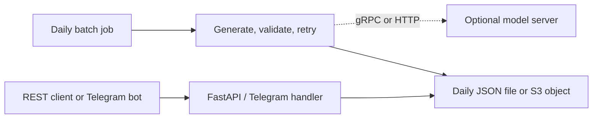

# Agata

Agata is a Russian-language daily horoscope API and Telegram bot. Choose a zodiac sign and one of four topics to get a short entertainment forecast. The batch job creates all 48 forecasts for a calendar day. The API and the bot read the published edition, so user requests take no model inference time.

The default generator uses original editorial templates. A bounded loop checks each model candidate for Russian text, sentence count, wrong zodiac signs, clear topic mismatches, and restricted financial claims. It retries once with the reason and uses an editorial fallback if both attempts fail. Generation, Telegram calls, and API reads use async I/O.



## Run locally with Docker

Requires Docker Compose 2.24 or later. The default stack needs no credentials.

```sh
docker compose up --build -d
curl -fsS 'http://localhost:8000/v1/horoscopes/today?sign=leo&topic=work'
```

Open [the API docs](http://localhost:8000/docs) to try the REST contract. The one-shot `generate` service publishes the first edition before the API starts. On a later calendar day, publish a new edition with `docker compose run --rm generate`. Pass an explicit date with `docker compose run --rm generate python -m agata generate --date 2026-12-01`. The named Docker volume retains editions between runs.

For local Telegram testing, create a development bot with BotFather and place its token in `.env` as `AGATA_TELEGRAM_BOT_TOKEN`.

```sh
cp -n .env.example .env
# Set AGATA_TELEGRAM_BOT_TOKEN in .env
docker compose --profile telegram up --build -d
```

Open your bot's private chat, send `/start`, and choose a sign and topic. The local container uses long polling. Telegram allows either polling or a webhook per bot, so use a dedicated development token for this flow. [Telegram Bot API](https://core.telegram.org/bots/api#getting-updates)

## REST API

| Route | Behavior |
| --- | --- |
| `GET /healthz` | Process health |
| `GET /readyz` | Checks that today's complete edition is available |
| `GET /v1/horoscopes/today?sign=leo&topic=work` | Returns date, timezone, sign, topic, forecast text and release ID |
| `POST /v1/telegram/webhook` | Handles private-chat updates after verifying the webhook secret |

Topics are `general`, `relationships`, `work`, and `finance`. The default day boundary is `Europe/Moscow`. Invalid enum values return `422`. An unpublished day returns `503`; the bot offers the user a chance to retry. Re-running generation for a published date returns the existing edition. One atomic write publishes the full matrix.

## Development

```sh
python3.12 -m venv .venv
source .venv/bin/activate
python -m pip install --upgrade pip
python -m pip install -r requirements.lock --group dev
python -m agata generate
python -m uvicorn agata.api:app --reload
```

Run `ruff check .` and `pytest -q`. Tests cover the API contract, concurrent publication, S3 conditional writes, bounded generation concurrency, model retry and fallback, a real loopback gRPC call, and Telegram requests through an HTTP mock. To refresh runtime pins, run `pip-compile --output-file requirements.lock pyproject.toml` with pip-tools on Python 3.12, then run tests and the Docker smoke check.

## Recover a degraded edition

The batch command prints a JSON summary with `health`, `fallbacks`, and `fallback_reasons`. A complete edition with fallback forecasts is available to readers and reports `health=degraded`. A deliberate editorial run reports `health=healthy`.

After restoring the model, use the same store and configure the model backend and release ID. Run recovery for the affected date.

```sh
python -m agata recover --date 2026-12-01
```

Recovery retries only fallback forecasts and keeps any still-valid entries. It replaces the whole edition atomically when at least one fallback is resolved and records the new model, prompt version, and release ID on each recovered entry. A stale write reports `conflict` and exits with status 1. `no_improvement` leaves the published edition available for readers and indicates that the model still needs attention. See the [AWS guide](docs/aws.md) for the log filter and S3 rollback.

## AWS deployment

The [deployment guide](docs/aws.md) covers the two images, Telegram webhooks, and an EventBridge schedule that passes the original scheduled timestamp through Step Functions to ECS. Delayed tasks use the same target date.

## Model integration

The batch job can call a model server that implements the [Protobuf contract](agata/rpc/model.proto). Requests carry the model ID, sign, topic, date, attempt number and formatted prompts. A single async channel handles concurrent requests. The defaults are four concurrent forecasts and a 10-second request deadline, configurable through `AGATA_GENERATION_CONCURRENCY` and `AGATA_MODEL_TIMEOUT`. Each forecast gets at most two attempts before an editorial fallback.

To try the gRPC path without a trained model, use two terminals with the local Python environment active. Start the loopback demo server:

```sh
python -m agata serve-template-model
```

Then publish an isolated test edition using the async gRPC client:

```sh
AGATA_GENERATOR=grpc AGATA_MODEL_GRPC_TARGET=127.0.0.1:50051 \
  AGATA_MODEL_GRPC_TLS=false AGATA_MODEL_ID=editorial-v1 \
  AGATA_RELEASE_ID=grpc-demo AGATA_EDITION_DIR=data/grpc-demo \
  python -m agata generate
```

For a remote endpoint, use its hostname and port with the default TLS setting. Optionally provide `AGATA_MODEL_API_KEY` as bearer metadata. Existing OpenAI-compatible endpoints still work with `AGATA_GENERATOR=openai_compatible`, `AGATA_MODEL_ENDPOINT`, and `AGATA_MODEL_ID`. Telegram uses its HTTPS Bot API and public API clients use REST.

After editing the Protobuf contract, regenerate the Python stubs:

```sh
python -m grpc_tools.protoc -I. --python_out=. --grpc_python_out=. agata/rpc/model.proto
```

## LoRA training and evaluation

[The LoRA workflow](lora_train/README.md) has training and scoring commands, example JSONL, and a fixed 144-prompt evaluation across all signs and topics. It compares editorial templates, the base model with the Agata prompt, and that same model with a LoRA adapter. It captures raw and post-validation answers, creates blind rating files, and reports fallback, retry, repetition, and runtime metrics.

The included training examples are for verifying the pipeline. A larger licensed corpus and results from blind evaluation are still needed before selecting a model for release.

[Architecture and original notebook review](ARCHITECTURE.md)
